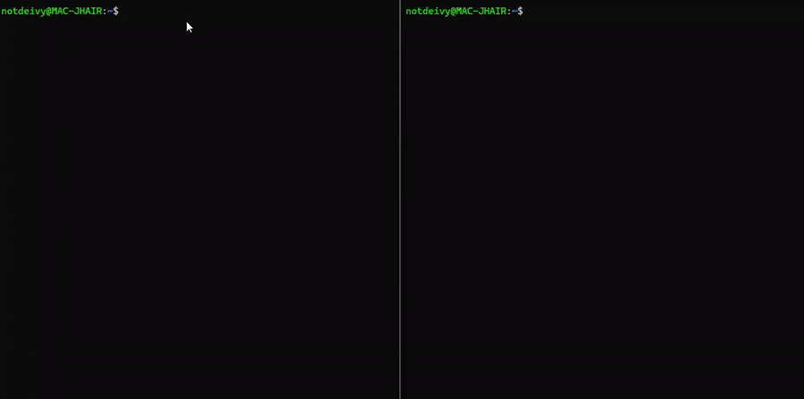

# TokenBurn

**Mide cuántos tokens de Claude Code se queman en writes que nunca llegan al diff final.**



Claude Code a veces escribe un archivo, lo reescribe, y al final el cambio que sobrevive es otro. Todo lo que se escribió y se descartó sigue costando tokens. TokenBurn te muestra cuánto de tu sesión fue eso.

Si usas Claude Pro o Max, quemar tokens en writes descartados te acerca antes al límite de uso de tu ventana. Si usas la API, se traduce en costo directo.

 

> **Alcance:** solo Claude Code en esta versión.

## Qué hace

- Lee una sesión de Claude Code (`~/.claude/projects/`).
- Cuenta los tokens de entrada, salida y caché.
- Identifica los turnos cuyos writes no sobreviven al diff final ("burn").
- Lista los archivos tocados, con líneas añadidas y eliminadas.
- Muestra el costo equivalente a la tarifa de API.

## Instalación

```bash
uv tool install git+https://github.com/deivycom21-cell/tokenburn
```

## Uso

```bash
tokenburn list
tokenburn analyze ~/.claude/projects/<proyecto>/<sesion>.jsonl
tokenburn analyze <sesion>.jsonl --json
tokenburn analyze <sesion>.jsonl --share
```

- `--json`: salida estructurada para otras herramientas.
- `--share`: oculta rutas completas (solo nombres de archivo) para que puedas compartir el reporte sin exponer tu estructura de carpetas.
- `--no-funnel` o `TOKENBURN_NO_FUNNEL=1`: quita la línea final con el enlace.

## Ejemplo

```text
TokenBurn Report
Session: sess.jsonl
Model:   claude-sonnet-4-6

Tokens
  Input:      300
  Output:     150
  Total:      450

API-equivalent cost: $0.0032
⚠ This is the API rate. If you use Claude Pro/Max, your actual
  cost per session is covered by your subscription.

Burn (writes not in final diff)
  Burned turns:  1 / 3 write turns (33.3%)
  Burned tokens: 150 / 450 total (33.3%)
```

## Cómo se mide el burn

Solo cuentan los writes cuyo resultado no sobrevive en el diff final.

| Herramienta | ¿Cuenta como write? |
|---|---|
| `Write`, `Edit`, `MultiEdit` | Sí |
| `Bash` con redirección (`>`, `>>`, `tee`) | Sí |
| `Bash` con `rm`, `mv`, `cp`, `mkdir`, `touch` | Sí |
| `Bash` con `git add`, `git commit`, `git push` | Sí |
| `Bash` con checks (pytest, eslint, mypy…) | No |
| `Read`, `Glob`, `Grep` | No |

Dentro de una sesión, un turno con writes cuenta como quemado cuando todos esos archivos son sobrescritos por un turno posterior. Los tokens de razonamiento previos a un fallo no se cuentan en esta versión.

## Privacidad y red

TokenBurn no abre conexiones de red. Lee archivos locales y no envía nada a ningún servicio. La tabla de precios viene incluida en el paquete. Puedes verificarlo: el código está en `src/`, y `tests/test_no_network.py` comprueba que el análisis no abre sockets.

## Limitaciones

- El costo es la tarifa de API, no lo que pagas en una suscripción Pro o Max.
- La detección de alcance es una heurística: marca archivos cuyo nombre no aparece en tus mensajes con `[not mentioned]`. No es un detector de cambios fuera de alcance.
- Solo soporta sesiones de Claude Code en esta versión.

## Contribuir

Issues y pull requests son bienvenidos. Corre los tests con:

```bash
uv sync --extra dev
uv run pytest -q
```

Si te sirvió, una estrella en el repo ayuda a que más gente lo encuentre.

## Licencia

MIT. Ver [LICENSE](LICENSE).

---

*Not affiliated with, endorsed by, or sponsored by Anthropic. Claude® is a trademark of Anthropic.*
